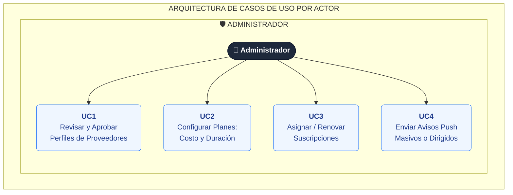

# DistroYaAdmin
DistroYaAdmin

- UC1: Revisar y Aprobar Perfiles de Proveedores
- UC2: Configurar Planes de Suscripción: Costo y Duración
- UC3: Asignar / Renovar Suscripción a Proveedores
- UC4: Enviar Avisos Push Masivos o Dirigidos

# Caso de Usos

